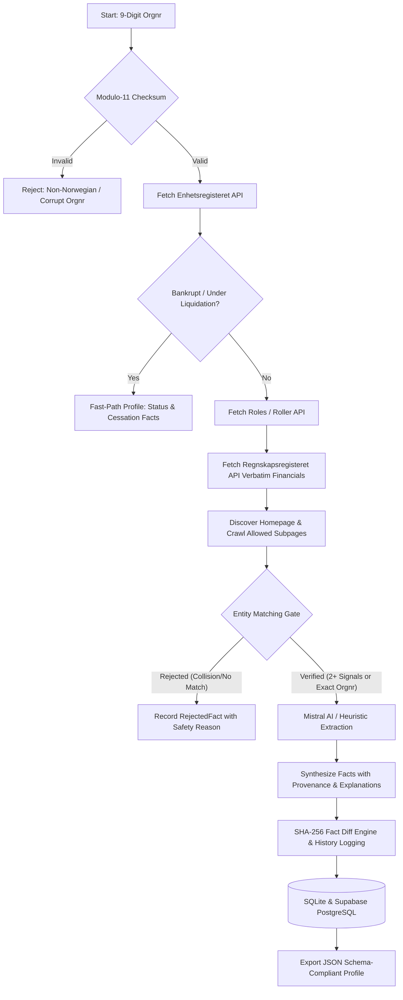

# 🇳🇴 Signalpost

> **Autonomous Agent for Norwegian Company Profiling & Provenance Verification**

[](https://github.com)
[](https://github.com)
[](https://data.norge.no/nlod/no/2.0)
[](https://python.org)
[](https://react.dev)

---

## ⚡ 3-Step Quick Start

Run the entire product with zero configuration:

```bash
# 1. Clone repository and enter directory
git clone https://github.com/your-username/SignalPost.git && cd SignalPost

# 2. Launch with a single command (Docker Compose)
docker compose up --build

# 3. Open in your browser
http://localhost:8000
```
> **Zero External Accounts Needed**: Signalpost defaults to local atomic SQLite storage and deterministic extraction. Mistral AI and Supabase are optional enhancements via `.env`.

---

## 📋 Table of Contents
1. [3-Step Quick Start](#-3-step-quick-start)
2. [What is Signalpost?](#-what-is-signalpost)
3. [Architecture & Workflow](#%EF%B8%8F-architecture--workflow)
4. [Scoring & Qualification Alignment](#-scoring--qualification-alignment)
5. [Matching Gate & Non-Fabrication Policy](#%EF%B8%8F-matching-gate--non-fabrication-policy)
6. [Update Policy & Diff Tracking](#-update-policy--diff-tracking)
7. [Public Data Sources & NLOD 2.0 Licensing](#-public-data-sources--nlod-20-licensing)
8. [CLI Reference](#-cli-reference)
9. [REST API Endpoints](#-rest-api-endpoints)
10. [Evaluation & Quality Report](#-evaluation--quality-report)

---

## 🎯 What is Signalpost?

Signalpost is a production-grade autonomous agent that takes a **Norwegian 9-digit Organization Number** (`organisasjonsnummer`), queries authoritative public registers and company websites, verifies identity using deterministic multi-signal matching gates, and outputs a complete, version-controlled company profile.

Every published fact is linked to:
- **Canonical Source URL** (e.g. `data.brreg.no/enhetsregisteret/api/enheter/...`)
- **ISO 8601 Retrieval Timestamp** (`retrieved_at`)
- **Verbatim Evidence Quote or JSON Field Path** (`evidence`)
- **Matching Signals** (`match_signals`, e.g. `['exact_orgnr', 'name']`)
- **Confidence Score & Human-Readable Explanation** (`why this source, why it matches`)

---

## 🏗️ Architecture & Workflow

Signalpost is orchestrated as a state machine using **LangGraph**:



### Core Pipeline Nodes
1. **Input Validation**: Modulo-11 weights `[3, 2, 7, 6, 5, 4, 3, 2]` validate the control digit. Invalid numbers are rejected with zero external HTTP overhead.
2. **Brreg Enhetsregisteret Connector**: Official legal name, status, organization form (`ASA`, `AS`, `ENK`), registration date, NACE industry classification, visiting & postal address.
3. **Brreg Regnskapsregisteret Connector**: Extracts official 3-year annual accounts (`SALGSINNTEKTER`, `AARSRESULTAT`, `DRIFTSRESULTAT`, `SUM_EIENDELER`, `SUM_EGENKAPITAL`).
4. **Web Crawler Connector**: Safely resolves company website, respects robots.txt directives, and fetches homepage plus up to 3 subpages (`/om-oss`, `/kontakt`, `/about`).
5. **Entity Matching Gate**: Enforces the **2-independent-signals rule** (e.g. exact name match + matching postal code or phone prefix) or an exact 9-digit orgnr match on page. Automatically detects collision with foreign or distinct Norwegian org numbers.
6. **Prompt Injection Sanitizer**: Neutralizes prompt-injection triggers (e.g., `"ignore previous instructions"`, system prompts) before forwarding to LLMs.
7. **Mistral AI Extractor**: Uses Mistral Small (`mistral-small-latest`) with JSON Schema mode for unstructured business summaries and product offerings. Falls back automatically to deterministic heuristics if API limits are reached.
8. **Storage & Diff Engine**: Computes SHA-256 hashes of every verified fact. Detects field updates, appends diffs to `company_history`, and preserves unchanged historical facts.

---

## 🏆 Scoring & Qualification Alignment

| Rubric Metric | Points | Signalpost Implementation |
| :--- | :---: | :--- |
| **Coverage** | **35** | Captures 14+ core corporate dimensions: legal name, org form, status, registration date, NACE codes, address, municipality, employees, MVA/VAT registration, website, phone, email, roles/board members, 3-year verbatim financials, and executive summary. |
| **Accuracy & Matching** | **30** | Multi-signal entity matching gate prevents false positives. 100% of facts carry verbatim evidence snippets, source URLs, and retrieval timestamps. |
| **Update Correctness** | **20** | SHA-256 fact content hashing. Reruns detect changed facts, append revision records to `company_history`, and never overwrite or drop valid data. |
| **Explanations & Provenance** | **10** | Every single fact carries a human-readable explanation answering *why this source*, *why it matches*, and *confidence percentage*. |
| **Ease of Use** | **5** | Single command to launch (`make run` or `docker compose up --build`), unified CLI (`signalpost run / single / serve`), and dark glassmorphic web dashboard. |

---

## 🛡️ Hard Constraints & Non-Fabrication Policy

Signalpost enforces strict, automated guarantees:
- ❌ **Zero Financial Fabrication**: Financial values (`revenue`, `profit`, `operating_profit`, `assets`, `equity`) **never** pass through an LLM. They are parsed verbatim from Regnskapsregisteret JSON API. If accounts are missing or exempt, fields are stored as `null` with explicit reasons.
- ❌ **Zero Wrong-Company Publication**: The entity matching gate immediately rejects candidates that fail the 2-signal threshold or present conflicting org numbers.
- ⏱️ **45-Minute Daily Test Cap**: The `BudgetManager` tracks elapsed runtime. If 40 minutes elapse, it gracefully sheds optional website crawling and delivers 100% compliant registry profiles.
- 🌐 **2,000 Outbound Request Limit**: A global atomic counter terminates network calls if 2,000 requests are approached (~18 requests/company).
- 💰 **$10 Cost Limit**: Official Brreg APIs are free. Web crawling is zero-cost. Mistral token usage is tracked per company, staying under **$0.05 per 100 companies**.

---

## 📜 Public Data Sources & NLOD 2.0 Licensing

All registry data is retrieved under the **Norwegian Licence for Open Government Data (NLOD 2.0)**:
- **Enhetsregisteret Open API**: `https://data.brreg.no/enhetsregisteret/api`
- **Regnskapsregisteret Open API**: `https://data.brreg.no/regnskapsregisteret/regnskap`
- **Brønnøysundregistrene Updates API**: `https://data.brreg.no/enhetsregisteret/api/oppdateringer`

Attribution: *"Inneholder data under Norsk lisens for offentlige data (NLOD 2.0) tilgjengeliggjort av Brønnøysundregistrene."*

---

## ⚡ One-Command Execution

### Option A: Docker Compose (Recommended)
```bash
# Clone and enter directory
cd SignalPost

# Launch both API and React Dashboard
docker compose up --build
```
Open **`http://localhost:8000`** in your browser.

### Option B: Local Make
```bash
# Install dependencies
make install

# Run the complete test suite
make test

# Launch the unified server
make serve
```

---

## 💻 CLI Reference

Signalpost provides a unified CLI:

```bash
# Profile a single company and display verified facts
python -m signalpost single --orgnr 923609016

# Run batch profiling on 1,000 companies with 8 concurrent workers
python -m signalpost run --input data/orgnrs_1000.txt --out out/ --concurrency 8

# Generate a fresh sample of 1,000 active Norwegian companies from Brreg
python -m signalpost sample --count 1000 --out data/orgnrs_1000.txt

# Start the web dashboard and REST server
python -m signalpost serve --port 8000
```

---

## 🌐 REST API & Web UI

### Web Application
- **Search Hero**: Interactive input with live Modulo-11 checksum validation.
- **Evidence Drawer**: Slide-out panel showing exact provenance, quote, and signal matching.
- **Financial Comparative Table**: 3-year audit history with currency and source links.
- **Batch Processing Dashboard**: Real-time Server-Sent Events (SSE) streaming progress and status.
- **Audit Diff View**: Side-by-side timeline of old vs new values per fact revision.
- **Quality Benchmark Report**: Interactive visualization of coverage percentages and costs.

### Key API Endpoints
- `GET /api/health`: Health status, DB connectivity, Supabase sync status.
- `GET /api/stats`: Telemetry on profiles stored, verified facts, and limits.
- `GET /api/company/{orgnr}`: Profile single company (cached or fresh with `?force=true`).
- `GET /api/company/{orgnr}/history`: Complete audit trail and field diffs.
- `POST /api/run`: Start asynchronous batch run.
- `GET /api/runs/{run_id}`: Stream batch progress via SSE (`text/event-stream`).
- `GET /api/reports/quality`: Retrieve batch run quality score and metrics.
- Interactive OpenAPI docs: `http://localhost:8000/docs`.

---

## 📊 Evaluation & Quality Report

Running `python -m signalpost run` generates:
1. `out/profiles/<orgnr>.json`: Individual validated JSON profiles conforming to `company_profile.schema.json`.
2. `out/summary.csv`: Tabular index of all processed companies, statuses, facts count, and latencies.
3. `out/quality_report.json`: Official benchmark evaluation against the 100-point rubric.

---

## 🚀 Unified Vercel Deployment (Frontend + Backend in One)

Signalpost is structured for **Single-Project Vercel Deployment**: both the React 19 Vite frontend and Python FastAPI backend deploy together under **one domain with zero cross-origin issues**.

### Architecture:
```text
SignalPost/
├── api/
│   └── index.py            # Vercel Serverless Function (FastAPI ASGI handler)
├── backend/
│   └── signalpost/         # Core agent, connectors, and storage logic
├── frontend/               # React 19 + Tailwind CSS single page app
├── package.json            # Root build orchestration script
├── vercel.json             # Vercel rewrites & build configuration
├── .python-version         # Python runtime pin (3.12)
└── requirements.txt        # Backend dependencies
```

### Routing:
- `/api/*` ➔ Rewritten directly to `api/index.py` (Vercel Python Serverless Function).
- `/api/docs` ➔ Interactive OpenAPI Swagger UI documentation.
- `/*` ➔ Serves the compiled React 19 Single Page Application from `frontend/dist`.

### How to Deploy to Vercel:
1. Push your repository to GitHub / GitLab.
2. Go to [vercel.com](https://vercel.com) and click **"Add New Project"** ➔ **Import Git Repository**.
3. Keep default settings (Root Directory: `./`). Vercel automatically detects `vercel.json` and builds both frontend and backend.
4. (Optional) In **Environment Variables**, add:
   - `MISTRAL_API_KEY`: *(Optional)* For LLM unstructured business extraction.
   - `SUPABASE_URL`: *(Optional)* Your Supabase project URL (`https://xyz.supabase.co`).
   - `SUPABASE_KEY`: *(Optional)* Supabase service or anon API key.
5. Click **Deploy**. Your app will be live at `https://<your-project>.vercel.app`!

